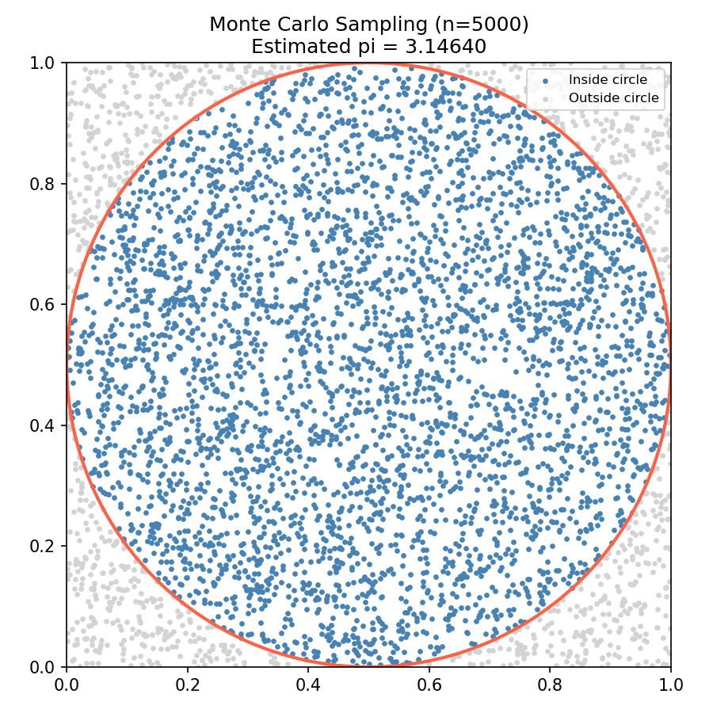
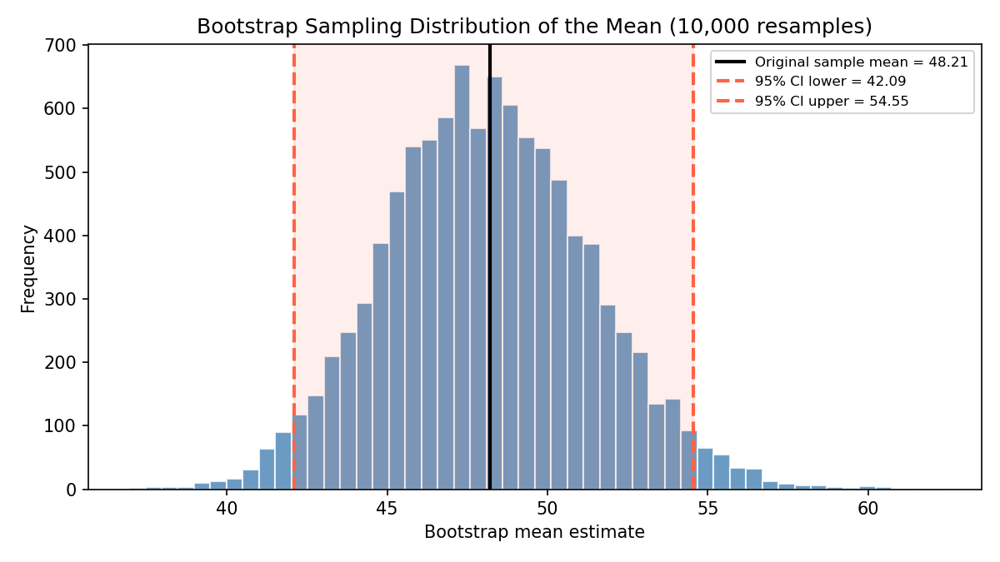
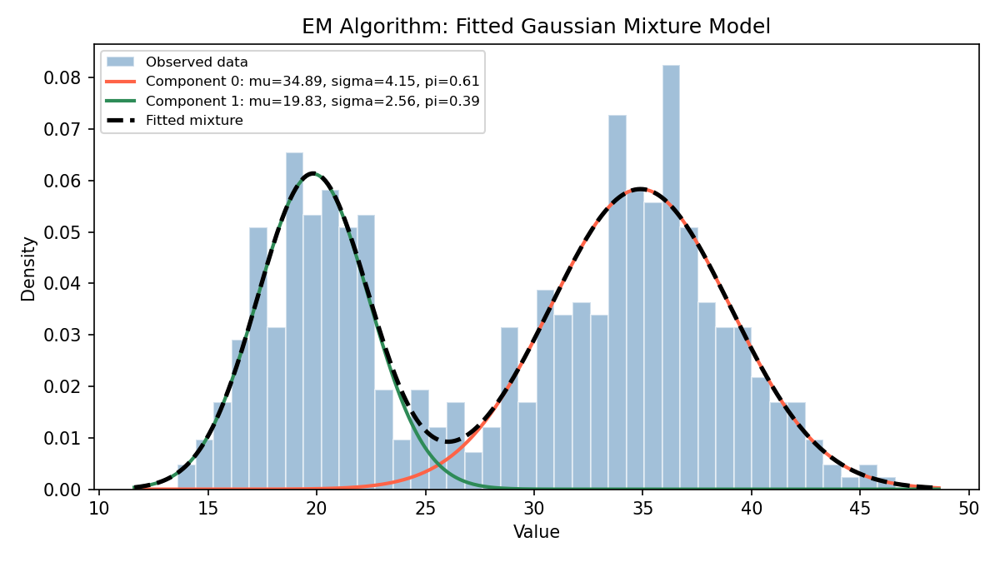

# 01 — Algorithm Implementations

From-scratch implementations of three classical statistical algorithms in Python, with step-by-step visualizations and analysis.

---

## Contents

| Algorithm | Description | Notebook |
|-----------|-------------|----------|
| Monte Carlo | Estimate π via random sampling and geometric probability | [monte_carlo_pi.ipynb](./monte_carlo/monte_carlo_pi.ipynb) |
| Bootstrap | Confidence intervals via resampling, without distributional assumptions | [bootstrap.ipynb](./bootstrap/bootstrap.ipynb) |
| EM Algorithm | Gaussian Mixture Model parameter estimation via Expectation-Maximization | [em_algorithm.ipynb](./em_algorithm/em_algorithm.ipynb) |

---

## Monte Carlo — Estimating π

Randomly scatter points inside a unit square. The fraction landing inside the inscribed circle approximates π/4, so π can be recovered from the ratio alone.

**Key visualizations:** scatter plot of sampled points · convergence to true π · error decay rate (O(1/√n)) · summary table



---

## Bootstrap — Confidence Intervals

Estimate the sampling distribution of any statistic (mean, median, or custom) by resampling the observed data with replacement — no normality assumption required.

**Key visualizations:** bootstrap sampling distribution · CI stability vs. number of resamples · comparison with traditional normal-theory CI · bootstrap applied to the median



---

## EM Algorithm — Gaussian Mixture Model

Given data drawn from two overlapping Gaussian distributions with unknown labels, recover all component parameters (means, standard deviations, mixing weights) through iterative Expectation-Maximization.

**Key visualizations:** observed mixture data · fitted GMM vs. data · log-likelihood convergence · parameter evolution across iterations · soft cluster assignments



---

## Requirements

```bash
pip install numpy matplotlib scipy
```
