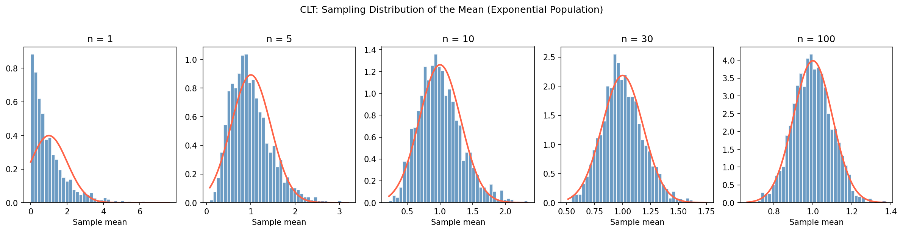
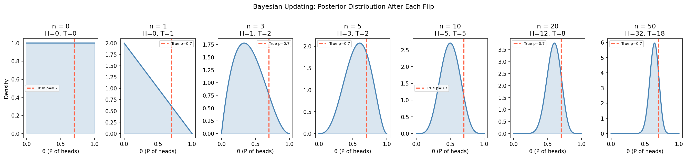
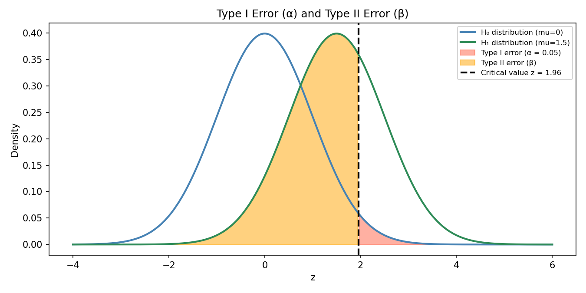

# 02 — Statistical Visualizations

Interactive and static visualizations of three foundational statistical concepts, built with NumPy, SciPy, and Matplotlib.

---

## Contents

| Topic | Description | Notebook |
|-------|-------------|----------|
| Central Limit Theorem | Visualizing convergence to normality across sample sizes and population shapes | [clt.ipynb](./clt/clt.ipynb) |
| Bayesian Updating | Step-by-step posterior updating with Beta-Binomial conjugacy | [bayesian_updating.ipynb](./bayesian_updating/bayesian_updating.ipynb) |
| Hypothesis Testing | p-values, rejection regions, Type I/II errors, and statistical power | [hypothesis_testing.ipynb](./hypothesis_testing/hypothesis_testing.ipynb) |

---

## Central Limit Theorem

No matter the shape of the population distribution, the sampling distribution of the mean converges to normal as sample size grows. Demonstrated across exponential, uniform, and bimodal populations.

**Key visualizations:** sampling distribution across n · cross-distribution comparison · Q-Q plots · standard error decay



---

## Bayesian Updating

Starting from a flat prior, beliefs about an unknown parameter θ are updated flip by flip using the Beta-Binomial conjugate model. Shows how prior strength, data volume, and uncertainty interact.

**Key visualizations:** sequential posterior updates · effect of prior strength · posterior mean convergence · credible interval narrowing



---

## Hypothesis Testing

A visual guide to frequentist hypothesis testing: what a p-value actually measures, how the choice of α determines the rejection region, the trade-off between Type I and Type II errors, and how power depends on effect size and sample size.

**Key visualizations:** p-value illustrated · rejection regions at α = 0.10 / 0.05 / 0.01 · Type I and Type II errors · power analysis



---

## Requirements

```bash
pip install numpy matplotlib scipy


```
